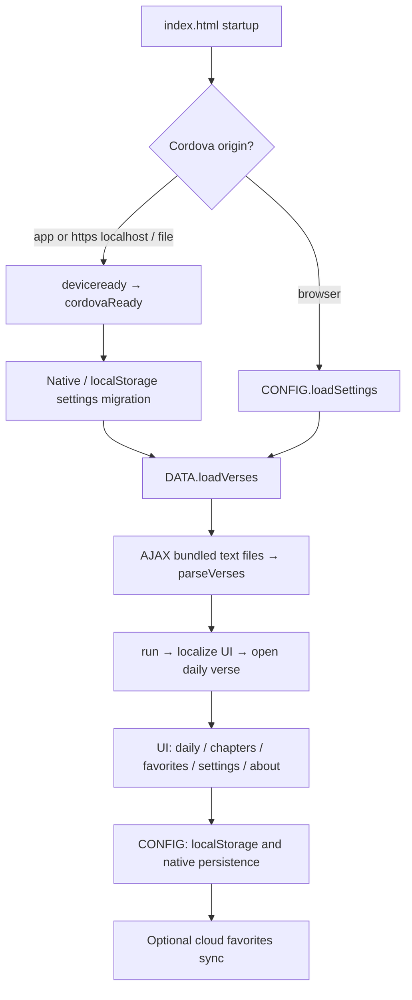

# Shantideva project map

Last inspected: 2026-09-07. Start here for architecture; see [development](DEVELOPMENT.md) for commands and [task history](../log.md) for changes.

## Product

An offline multilingual reader for Shantideva's *Engaging in Bodhisattva Behavior* (Bodhicharyavatara). It shows a deterministic daily verse, ten chapters, favorites, up to three translations together, language/font/theme settings, and translator credits. Mobile notifications are platform-specific. This is a Cordova application, not SwiftUI or React Native. The browser, iOS, and Android share the same frontend.

## Source map

| Path | Responsibility | Edit policy |
| --- | --- | --- |
| `src/web/index.html` | App markup and inline JavaScript: `CONFIG`, `UI`, `DATA`, startup | Main application source; preserve DOM IDs used by handlers |
| `src/web/css/custom.css` | Original layout, language typography and bundled font declarations | Preserve script-specific fonts and text direction |
| `src/web/css/modern.css` | Shared modern theme, spacing, controls, safe areas, responsive navigation | Preferred place for visual changes |
| `src/web/content/localize.js` | `LANG_LIST`, `TEXT_LANG_LIST`, localized UI strings and credits | Add translations here, avoid English-only UI |
| `src/web/content/text_*.txt` | Chapter headings and verse text for each translation | Content and translation rights must be preserved |
| `src/web/content/` | About material, logos and translations | Source assets |
| `src/web/icons/`, `src/web/lib/` | Existing icons, vendored jQuery 3.6.1 and jQuery UI 1.13.2 | Do not casually rewrite vendored code |
| `src/phonegap-plugin/DailyVersesPlugin/` | Custom Cordova plugin: JS bridge, Java implementation, Objective-C stub | Native integration source |
| `app/shantideva-phonegap/config.xml` | Release app identity, icons, platform preferences | Release configuration; local tooling derives its own copy |
| `app/shantideva-phonegap/package*.json` | Existing locked Cordova toolchain | Use `npm ci`, preserve lockfile |
| `app/shantideva-phonegap/cordova/plugins/` | Tracked legacy plugin snapshots | Not the active generated `plugins/` directory |
| `src/aws/` | Python 3.12 Lambda services, Serverless configuration and bundled dependencies | Production backend; not required to read/test locally |
| `src/icon/` | Editable artwork, source SVGs and historical icons | Inspect before changing assets |
| `android_releases/` | Historical release APKs | Do not regenerate during local development |
| `.github/workflows/build-ios.yml` | Existing signed iOS release and App Store upload workflow | Push to main/master can publish; not a test workflow |
| `scripts/dev.mjs`, root `package.json` | Local server, web build, isolated native setup/build/run | Supported development entry points |
| `tests/`, `playwright.config.mjs` | Browser regression suite | Test behavior and layouts across engines |
| `.local/cordova/` | Generated native dev project and build outputs | Ignored; never use as source of truth |
| `app/shantideva-web/`, mobile `www/`, `platforms/`, `plugins/` | Generated outputs | Do not edit directly |
| `tasks/`, `log.md` | Dated development history and evidence | Append one entry per meaningful task |

## Runtime map

`CONFIG` owns settings, language detection, favorite verse maps, device UUID and persistence. Existing storage keys include `uiLanguage`, `textLanguage`/`2`/`3`, `fontSize`, `colorTheme`, `favoriteVerses`, and cloud synchronization state. Keep their meaning stable to preserve existing users' data. Android also persists settings through the native plugin and includes migration logic.

`DATA` loads selected text files via AJAX and parses `***` chapter headings and blank-line verse boundaries. Verse ordering aligns translations. The daily selection derives a seeded index from the local date. `?verse=N` chooses an index for development. Changes to ordering or daily selection need cross-language and native review.

`UI` generates verse markup, favorites controls, chapter selectors and localized strings; jQuery UI supplies buttons and menus. Settings changes save and reload. Most handlers are inline and depend on global objects and DOM IDs. This is a small legacy SPA with no bundler or framework lifecycle.

## Platform differences

- Browser: localStorage persists settings/favorites; a fallback plugin object supplies no-op native methods.
- iOS: WKWebView serves packaged assets. The custom plugin's JavaScript implements iOS settings and cloud push registration; its Objective-C file is only an echo stub. Production push additionally depends on `PushNotification`, installed by the existing release CI. Local builds suppress registration and cloud writes.
- Android: Java classes load packaged text, persist preferences, schedule alarms, handle boot, and show notifications. `VerseAccess` reads `content/text_%s.txt` from assets.
- AWS: API Gateway routes registration, unregistration and favorite writes into Lambda/DynamoDB. The hourly `send-messages` job sends notifications. `serverless.yml` defaults to `prd` in `eu-central-1`. Local UI work requires none of these services.

## Known maintenance boundaries

The production configuration declares iOS 8.1.1 while the installed lock resolves 7.1.1 and CI requests 7.1.1; engine names also differ from normal `ios`/`android` names. Local setup deliberately uses the installed locked versions. A release toolchain consolidation should be its own task.

The original iOS scripts remove/re-add platforms and build releases; Android scripts assume Linux SDK paths and a private signing key. The existing CI deletes the lock and dynamically installs push/XHR plugins. These release paths are retained, not certified by local simulator tests.

No backend tests or native notification end-to-end tests existed at initial inspection. Vendored libraries and legacy plugin dependencies have deprecation warnings. UI modernization does not imply that release signing, push delivery, backend deployment, or Android packaging has been verified.

## Licensing

Original app code is offered under GPL v2 or GPL v3. Libraries/fonts retain their own licenses. The text translations belong to their translators and are not covered by the app's GPL grant. Preserve attribution and bundled license files.
